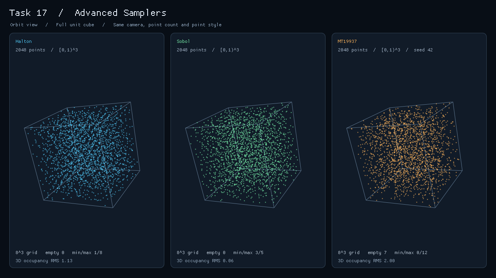

# Task 17 — Advanced Samplers

Compare **Halton**, **Sobol**, and **`std::mt19937`** in three unit cubes.
Generation, projection, and occupancy analysis run on the CPU. The viewer
uses the repository's existing OpenGL 3.3 setup to draw the result; no CUDA,
OptiX, Embree, or dedicated GPU is required.



## Run and reproduce

From the repository root:

```bash
make test-AdvancedSamplers
make run-AdvancedSamplers
./build/AdvancedSamplers --stats
./build/AdvancedSamplers --capture src/AdvancedSamplers/comparison.png
./build/AdvancedSamplers --view xy --capture src/AdvancedSamplers/projection-xy.png
```

Capture and interactive viewing need a graphical session; tests and stats do
not open a window. Defaults are 2,048 points per cloud and seed 42 for random.
Use `--count 512|2048|8192|16384` and `--view orbit|xy|xz|yz` to change the
initial view. In the viewer, left drag orbits, right drag pans in Orbit mode,
and the wheel zooms. Use **Tab** to hide controls and **F12** to write the
current view to `src/AdvancedSamplers/comparison.png`. The slice filters along
the hidden axis in projection mode, or along Z in Orbit mode. Occupancy stats
always describe the full cloud, not the slice.

## How the sequences work

- **Halton:** write the sample index in bases 2, 3, and 5, then reflect each
  base's digits across the radix point. For example, index 5 gives 0.04 in
  the base-5 coordinate.
- **Sobol:** use 32-bit direction numbers for each dimension. Dimension 1
  uses powers of two. Dimensions 2 and 3 use the primitive polynomials
  `x+1` and `x²+x+1` with initial numerators `(1)` and `(1,3)`. XOR the
  direction numbers selected by `n ^ (n >> 1)` and divide by `2^32`.
- **Random:** draw each coordinate with `std::uniform_real_distribution<double>`
  and a seeded `std::mt19937`. The same library and seed reproduce the cloud;
  the distribution's mapping need not match across standard libraries.

Halton and Sobol are unscrambled and start at index 1, omitting the origin.
Tests check known prefixes, range and reproducibility, and Sobol's aligned
512-point coverage **including index 0**. The displayed Sobol prefix instead
replaces that origin with a later sample, so it need not have exact dyadic
balance.

## Distribution observations

For 2,048 points, each cell of an `8 × 8 × 8` grid would ideally hold four.
RMS below means the root mean square of `(cell count − 4)` across all cells.

| Generator | Empty cells | Min–max count | RMS |
|---|---:|---:|---:|
| Halton | 0 | 1–8 | 1.13 |
| Sobol | 0 | 3–5 | 0.06 |
| MT19937 (seed 42) | 7 | 0–12 | 2.00 |

The [XY projection](projection-xy.png) shows repeated diagonal motifs for
Sobol even though its 3D occupancy is the most even at this scale. Halton's
projection appears less visibly regular, while the random cloud has more
visible clumps and gaps. These are observations for this count, seed, and bin
alignment—not a general discrepancy ranking or proof of independence.

## Lab verification (machine 014)

Built and ran `make test-AdvancedSamplers` on machine 014 using GCC 13.3.0
and CMake 3.28. The sampler self-tests passed. The viewer exported both the
orbit and XY views at 1280 × 720 using the lab's graphical session (`DISPLAY=:0`).
Both captures were copied back and matched the repository PNGs byte for byte.
The lab's `--stats` output matched the table above. No CUDA was needed.

Submit `comparison.png` if Canvas displays a file upload. If it asks for a
link, use the pushed repository image URL and check that the instructor has
access. The XY image is supplemental evidence.
