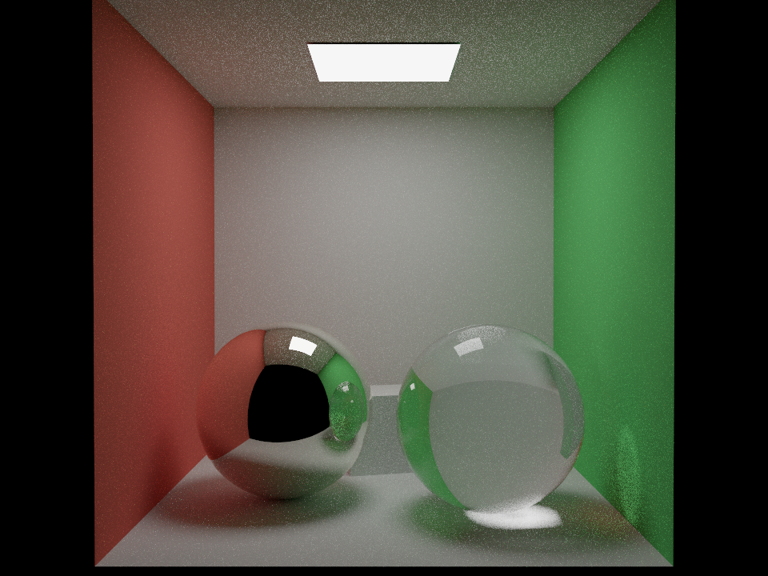
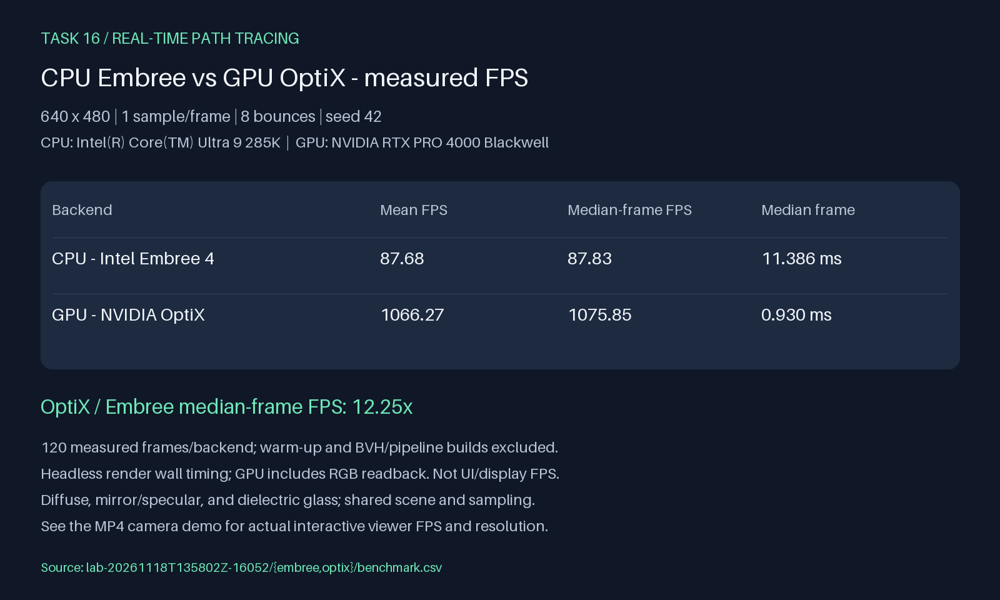

# Task 16 — verified Embree/OptiX results

Run on lab computer `014`, November 18, 2026. This is **Task 16: real-time
Embree/OptiX path tracing**, not Task 15's brute-force CPU/CUDA renderer.



## Submission deliverables

The successful run was retrieved from:

```text
~/3D-Graphics-CP24/src/RealtimePathTracer/output/lab-20261118T135802Z-16052/
```

All remote files were downloaded to the same relative directory in this
repository and verified against their remote SHA-256 hashes. Images and a
decoded video frame were visually inspected.

- **Camera demonstration:** [demo.mp4](output/lab-20261118T135802Z-16052/demo.mp4).
- **GPU rendered scene:** [optix/render.png](output/lab-20261118T135802Z-16052/optix/render.png).
- **CPU rendered scene:** [embree/render.png](output/lab-20261118T135802Z-16052/embree/render.png).
- **FPS comparison image:** [comparison.png](output/lab-20261118T135802Z-16052/comparison.png).
- **Viewer screenshot with live FPS:** [optix/viewer.png](output/lab-20261118T135802Z-16052/optix/viewer.png).
- **Raw measurements and validation:** [run directory](output/lab-20261118T135802Z-16052/).

The scene includes diffuse walls, an ideal specular mirror sphere, and a glass
sphere with Fresnel reflection/refraction and total internal reflection. Final
stills use **960 × 720, 256 samples/pixel, 8 bounces**.

The **1280 × 720 H.264 MP4, 30.16 seconds**, concatenates actual Embree and OptiX viewer framebuffer recordings,
including backend and FPS overlays. Camera movement is a **scripted orbit with
pauses for progressive refinement**, not a claim of manually dragging the
mouse. Frames are encoded using measured timestamps rather than an invented
playback FPS. A manually controlled recording is also supported; see README.

Upload the MP4 to an instructor-accessible YouTube/Drive link and submit that
URL in Task 16's Web URL field. A local file path is not a public video URL.

## Hardware and toolchain

- CPU: Intel Core Ultra 9 285K, **24 CPU workers**.
- CPU acceleration: **Intel Embree 4.3.0**.
- GPU: **NVIDIA RTX PRO 4000 Blackwell**, compute capability 12.0.
- GPU acceleration: **NVIDIA OptiX SDK 9.1.0**, device target `compute_120`.
- Ubuntu 24.04, GCC 13.3, CUDA Toolkit **13.0.88**, CMake 3.28.3.
- NVIDIA driver **595.99.02**. The driver's CUDA API 13.2 support does not mean
  the installed compiler toolkit is 13.2.
- Both backends use the same procedural 4440-triangle scene and shared
  path-shading code. Production intersection queries use their acceleration
  structures; brute-force traversal is only an independent test reference.

## CPU versus GPU performance in FPS

Matching workload: **640 × 480, 1 sample/frame, 8 bounces, seed 42**.
Each backend has 10 warm-up frames, followed by 120 measured frames.
Sample indices advance each frame. Both run on the same computer.

| Backend | Mean FPS | Median-frame FPS | Median frame time | p95 frame time |
| --- | ---: | ---: | ---: | ---: |
| CPU — Intel Embree | 87.68 | 87.83 | 11.386 ms | 12.096 ms |
| GPU — NVIDIA OptiX | 1066.27 | 1075.85 | 0.930 ms | 0.942 ms |

**OptiX/Embree median-frame FPS ratio: 12.25×.**



These are **headless render-wall FPS**, including OptiX RGB readback. They are
not UI refresh rates or a claim that the displayed camera demo runs at 1076 FPS.
The video shows actual new-image and tracing/readback FPS separately.

Timing includes output allocation, shading/tracing, Embree worker creation/
joins, and OptiX launch-parameter upload/readback. GPU scene/output buffers
persist across frames. Scene/BVH/pipeline creation, initial JIT, warm-up,
tone mapping, PNG encoding, file I/O and display are excluded. Build time and
GPU event-only launch time are recorded separately.

The separate high-quality stills took **5.95023 s on Embree** and **0.250045 s
on OptiX**. Those use 256 spp and a larger resolution, so their frame rates
must not be substituted for the matched 1-spp benchmark above.

## Correctness and recording evidence

- Both backends passed nearest-hit distance/material checks against independent
  exhaustive intersections, including inside-glass rays.
- Fresnel/TIR, finite nonnegative RGB, repeatability and progressive sample
  indexing checks passed.
- Embree/OptiX raw linear-RGB comparison: **RMSE 0.0000341285**, reference
  RMS 1.21123, maximum absolute component difference 0.00316614.
- **Compute Sanitizer: 0 errors** for the OptiX self-test.
- Both viewer smoke tests passed with camera movement and nonblack output.
- Both real viewer recordings were encoded, combined, and the lab script wrote
  `SUCCESS.txt`. Raw CSVs, summaries, logs and final images remain in the run.

## CUDA 13 build fix and reproduction

CUDA 13 attempted to validate PTX with `ptxas`, rejecting unresolved OptiX
intrinsics. Relocatable-device-code compilation alone did not resolve it.
The build now uses **`nvcc --optix-ir`** to produce
`PathTracerKernel.optixir`, consumed by `optixModuleCreate`. This completed
successfully on the actual GPU, not just in a host syntax check.

Remote base source commit was `fba79c01fe40624762d95c127241dd5f083e5d09` plus
the CMake OptiX-IR fix and device-module error-message update included with
this report. Earlier failed attempts are not used as deliverable evidence.

Regenerate the comparison image from the downloaded measurements (Pillow
required):

```bash
python scripts/render_realtime_comparison.py \
  src/RealtimePathTracer/output/lab-20261118T135802Z-16052
```

On the configured lab machine:

```bash
export OPTIX_ROOT="$HOME/.local/share/optix-dev-9.1.0"
export OPTIX_COMPUTE_ARCH=120 CPU_THREADS=24
export DISPLAY=:0 XAUTHORITY="/run/user/$(id -u)/gdm/Xauthority"
make lab-RealtimePathTracer
```

This generates a fresh result directory. Display/authentication paths are
specific to the lab user's active graphical session; no driver changes or
sudo are needed to reproduce the configured run.
