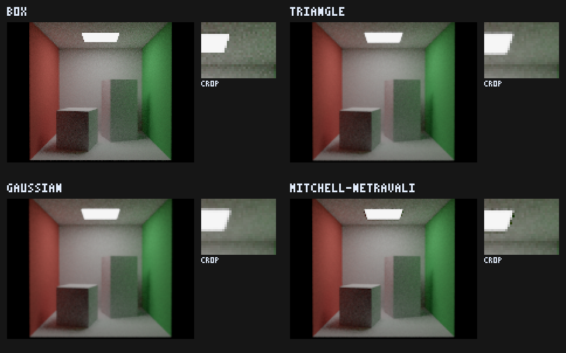

# Task 18 — Reconstruction Filters



The comparison includes all four explicitly required filters in a single PNG,
even though the assignment text says “3 outputs.” Each panel shows the same
low-resolution Cornell-box render at 2× with the same ceiling-light crop at 4×.
Both enlargements use nearest-neighbor scaling so the presentation does not
apply a second smoothing filter.

## Run from the repository root

```bash
make test-ReconstructionFilters
make run-ReconstructionFilters
```

The second command regenerates `output/comparison.png` and the four individual
PNGs under `src/ReconstructionFilters/`. Defaults: **160 × 120**, 128 samples
per image-plane cell, four diffuse surface evaluations, and seed 42.
The standalone build requires C++17, CMake, and threads only; rendering requires
no display, OpenGL, CUDA, or OptiX.

For a quicker preview:

```bash
./build/reconstruction/ReconstructionFilters --samples 16 --output-dir /tmp/filter-preview
```

## Reconstruction

Task 15's CPU integrator traces one shared set of jittered camera samples, with
a two-cell halo outside the crop. Each output pixel gathers those ray colors
in linear RGB using `w = f(dx) * f(dy)`, where distances are in pixels from the
pixel center. The result is `sum(w * RGB) / sum(w)`. If the signed weight sum
is too small for stable division, the renderer uses the local unweighted mean.

| Filter | One-dimensional kernel (zero outside support) |
|---|---|
| Box | `1` for `abs(x) < 0.5` |
| Triangle | `1 - abs(x)` for `abs(x) < 1` |
| Gaussian | `exp(-2*x*x) - exp(-8)` for `abs(x) < 2` |
| Mitchell–Netravali | Cubic with `B = C = 1/3`, radius 2 |

Mitchell's negative lobes are retained; negative RGB is clipped only at export.
All panels use identical exposure, Reinhard tone mapping, and sRGB encoding.
In this render, Box leaves more visible grain, Triangle and Gaussian soften the
light edge, and Mitchell preserves a sharper edge with slight ringing. The
tests verify known kernel values, support, symmetry, constant-color preservation
at the border, cross-pixel contributions, and thread-count determinism.

**Submit:** upload `output/comparison.png` to Canvas and push the source and
image to your course repository.
