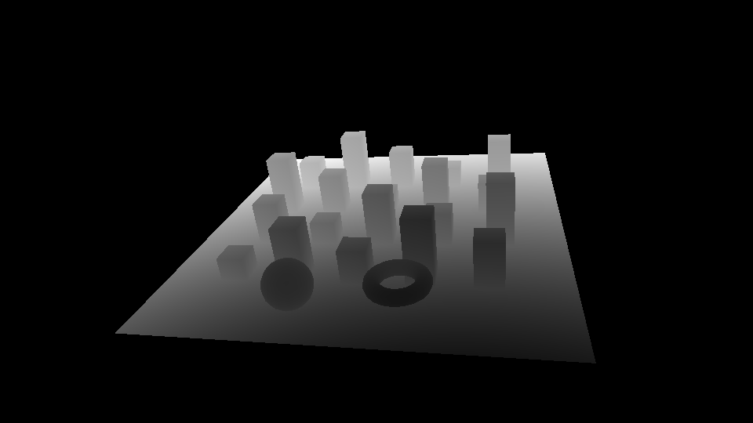

# Task 13: Shooting rays



Every pixel casts a primary ray from the camera into a triangle scene. A CPU
Moller–Trumbore test finds the nearest positive intersection. There is no BVH,
k-d tree, rasterized depth readback, lighting, or shadow-map input. OpenGL only
displays the completed grayscale pixel buffer.

## Build and reproduce

Run from the repository root. Requires the existing C++17, CMake, GLFW, OpenGL,
and GLM toolchain. PNG writing uses vendored `include/stb_image_write.h`, with
its upstream license included. No Python or image-conversion utility is needed.

```bash
make ShootingRays
./build/ShootingRays --self-test
./build/ShootingRays --render 960 540
```

The last command regenerates **`src/ShootingRays/depth_map.png`** using the
default camera, scene, automatic depth range, and 0.08 near brightness. It does
not create a window or need a graphical session. Optional output path:

```bash
./build/ShootingRays --render 640 360 /tmp/opencode/depth-preview.png
```

The checked-in image is 960 × 540. The scene contains 962 triangles: a ground
plane, staggered towers, a sphere, and a torus. The first measured Release
render took approximately 1.15 seconds on the development laptop; timings depend
on hardware and system load. Work is distributed across at most eight CPU
workers. Cost remains O(width × height × triangles).

## Interactive viewer

```bash
make run-ShootingRays
```

- Left drag outside the panel: orbit. Right drag: pan. Scroll: zoom.
- Click **Render** after moving the camera or changing resolution. The existing
  image remains visible, marked stale, until you render again.
- Camera changes are disabled during a render; progress updates without blocking
  the UI. Closing waits for active CPU work to finish.
- Near/far distance and near brightness change contrast without retracing.
- **Auto range** restores the finite hit-distance range.
- **Save PNG** exports the displayed depth image without UI, to the path above.
  It overwrites the previous image. A stale image saves the previous rendered
  view, not the newly positioned camera.
- Escape closes the viewer. Its layout is not saved to `imgui.ini`.

The image keeps its own aspect ratio inside the window. Sampling resolution is
independent of the framebuffer size. The window requires OpenGL 3.3 and a
working graphical session.

The viewer requests a fixed 1280 × 720 landscape window, including size limits
and a 16:9 aspect hint for tiling window managers. If Hyprland still tiles it,
focus the viewer and use your floating-window shortcut (or run
`hyprctl dispatch togglefloating` while the viewer is focused), then render again.

## Algorithm and mapping

1. Generate indexed meshes using the existing `EricStructure` and transform
   their vertices to world space once. Cache each triangle's two edge vectors.
2. Unproject each pixel center through inverse(projection × view). Normalize
   the direction from the camera position so intersection parameter `t` is a
   **world-space radial distance**, not nonlinear OpenGL depth or view-axis Z.
3. Test all triangles, on both sides; retain the smallest positive `t`. Mark
   misses with infinity. No near/far clipping is applied to intersections;
   projection planes only define the ray direction.
4. Compute `n = clamp((t - near) / (far - near), 0, 1)` for finite hits, then
   `intensity = floor + (1 - floor) * n`. Default floor is 0.08 so the nearest
   surface remains distinguishable from the black background. Setting floor
   to zero gives the strict [0,1] normalization. Misses are always black.
5. Quantize to an 8-bit grayscale PNG. All-miss images stay black; a constant
   hit-depth range maps to the midpoint instead of dividing by zero.

Both CPU storage and PNG rows are top-down; the display shader flips texture Y
to match. Black background is a miss, not a zero-distance surface. The sphere's
faceting is intentional low-poly geometry, not illumination.

## Verification

`--self-test` checks known distances, misses, behind-camera and parallel rays,
two-sided and degenerate triangles, nearest-hit selection, pixel axes, unit
directions, normalization, constant depth, and an all-miss render.

With a graphical session, `./build/ShootingRays --smoke-test` opens the viewer,
renders, checks a displayed grayscale pixel against its CPU source and checks
OpenGL errors, then exits automatically. This also exercises shader loading.

## Submission

Submit `depth_map.png` as the image, and commit/push this assignment's source,
build registration, image writer, documentation, and output image. Review the
diff first: unrelated local changes such as Project1's `imgui.ini` should not
be included accidentally.
