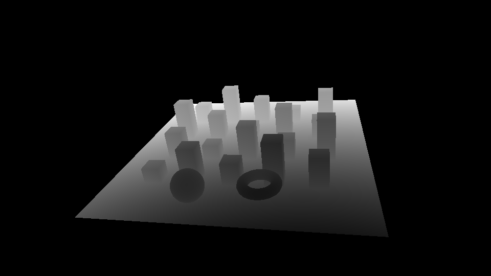

# Task 14: CUDA depth rendering — verified results

## Execution

- Date: 2026-11-18, 13:37:45 UTC (lab script start).
- Machine: lab SSH host `014`.
- Source commit: `fba79c01fe40624762d95c127241dd5f083e5d09`, branch `project`.
- GPU: NVIDIA RTX PRO 4000 Blackwell, compute capability 12.0.
- NVIDIA driver: 595.99.02; CUDA compiler: 13.0.88; runtime: 13.0.
- CMake: 3.28.3; host compiler: GCC 13.3.
- Command, from the remote repository root: `make lab-ShootingRaysCUDA`.

Primary ray generation and exhaustive nearest-triangle intersection ran on the
GPU, with no CPU fallback or BVH. CPU postprocessing normalized the GPU distances
and encoded the PNG. The image was downloaded from the lab machine; SHA-256
checks verified that all three downloaded artifacts matched the remote files.

## Validation

- GPU intersection self-tests: passed.
- CPU/GPU depth comparisons: 317 × 179, changed-camera 160 × 90, and 1 × 1.
- Across these 71,144 pixels: **zero hit-mask mismatches, zero distance failures,
  and zero observed maximum absolute depth error**.
- Empty-scene test: passed.
- Compute Sanitizer memcheck on both GPU self-tests and validation:
  **zero errors**.
- Final image inspected: landscape orientation, black background, dark near
  geometry, and lighter distant geometry.

## Output and timing

| Measurement | Result |
| --- | --- |
| Image | 960 × 540, 8-bit grayscale PNG |
| Triangles | 962 |
| Surface-hit pixels | 119,923 |
| Hit-distance range | 16.2385–33.2668 world units |
| Triangle upload | 0.0069 ms |
| CUDA kernel (CUDA events) | 2.5631 ms |
| Depth download | 0.1942 ms |
| Render call, including allocations but excluding cleanup | 3.4847 ms |
| Render + normalization, including cleanup | 4.4269 ms |

These are one measured render after a warm-up, not averages or a CPU/GPU speedup
benchmark. Wall timing excludes scene setup, warm-up, PNG encoding, and file I/O.
Finite distances map to `0.08 + 0.92 * clamp((t-min)/(max-min), 0, 1)`; missed
rays are black.

## Submission artifacts

- **Upload image:** [depth_map.png](depth_map.png).
- [GPU identity and timings](depth_map.png.txt).
- [Full build, validation, and sanitizer log](lab_run.log).
- Submit the repository's `project` branch or the results commit URL alongside
  the image.
