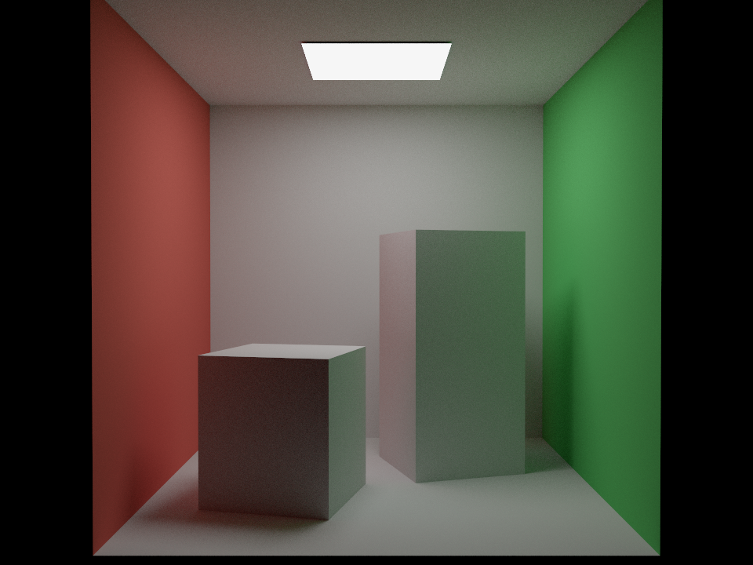

# Task 15 — verified CPU/CUDA results



## Submission files

- **Rendered scene:** [submission.png](output/lab-20261118T134436Z-14034/submission.png)
- **Comparison table image:** [comparison.png](output/lab-20261118T134436Z-14034/comparison.png)
- **Raw trials and evidence:** [lab output](output/lab-20261118T134436Z-14034/)

The final scene is a CUDA-rendered diffuse Cornell box with an area light,
soft shadows, and indirect color bleeding. It uses 960 × 720 pixels, 256
samples/pixel, and up to five diffuse surface evaluations. Its recorded render
wall time is **0.345718 seconds**, including GPU transfers and cleanup but not
PNG export. This final high-quality image has different settings from the
matched benchmark below and is not used to calculate CPU/GPU speedup.

## Same-machine performance comparison

Measured on lab computer `014`, November 18, 2026:

- CPU: Intel Core Ultra 9 285K, **24 CPU workers**.
- GPU: NVIDIA RTX PRO 4000 Blackwell, compute capability 12.0.
- Ubuntu 24.04; GCC 13.3; CUDA Toolkit 13.0.88; NVIDIA driver 595.99.02.
- Release build; procedural 36-triangle scene; no BVH or k-d tree.
- Matching settings: **640 × 480, 64 samples/pixel, seed 42**, fixed exposure.
- One full-configuration warm-up per backend, then three measured trials;
  CPU/GPU order alternates. Values below are medians.

| Mode | CPU render (s) | CUDA render (s) | CPU/CUDA speedup |
| --- | ---: | ---: | ---: |
| Direct lighting, 1 surface | 0.191576239 | 0.009160885 | 20.91× |
| Diffuse path tracing, 4 surfaces | 0.880209007 | 0.032503400 | 27.08× |

The primary comparison uses **render wall time** for both backends. CPU timing
includes output allocation, worker startup, tracing, and joins. CUDA timing
includes output/device allocation, scene upload, tracing, image readback, and
cleanup. Both exclude scene construction, initial context/JIT setup, warm-up,
validation, tone mapping, PNG encoding, and file I/O.

The CSVs also record kernel-only seconds for diagnostic purposes; those are
not substituted for CUDA render wall time in this table.

## Correctness evidence

Both CPU and CUDA self-tests passed, as did direct/path linear-RGB comparisons.
The matched path benchmark's maximum absolute RGB error was **5.66244e-7**,
with **RMSE 5.62426e-9**. Compute Sanitizer reported **zero errors** for both
the GPU self-tests and validation.

The output folder preserves the raw benchmark CSVs, backend summaries, matched
CPU/CUDA images, final-image metadata, full execution log, and `SUCCESS.txt`.
These results were generated remotely, downloaded to the local repository,
and visually checked. They are not laptop measurements.

## Reproduce

On the configured CUDA machine, from the repository root:

```bash
make lab-SimplePathTracer
```

This writes a fresh run directory, not the historical folder linked above.
The run used source commit `fba79c01fe40624762d95c127241dd5f083e5d09`;
later local commits before this report did not change the Task 15 renderer.

Regenerate the comparison image from the downloaded CSVs (requires Pillow):

```bash
python scripts/render_path_tracer_comparison.py \
  src/SimplePathTracer/output/lab-20261118T134436Z-14034
```

Upload `submission.png` as the assignment's rendered image. The comparison PNG
is supplementary evidence for the required time-in-seconds comparison. No
interactive video, Embree, or OptiX is needed for this Task 15 submission.
